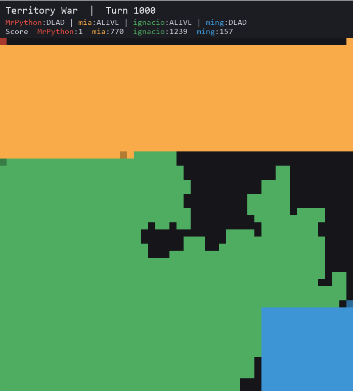

# 🏰 Domain Expansion (Territory War)

¡Bienvenido a **Domain Expansion**! Un vibrante y estratégico juego de conquista territorial por turnos para **4 jugadores** en una grilla bidimensional. Los jugadores compiten programando sus propios agentes/bots inteligentes en Python para dominar el tablero y encerrar a sus oponentes.

---

## 🎮 ¿De qué se trata el juego?

El objetivo principal es **conquistar la mayor cantidad de territorio posible** al finalizar la partida. 

### Reglas del Juego:
1. **Movimiento por turnos**: En cada turno, cada jugador avanza **exactamente una casilla** en dirección horizontal o vertical (ortogonal).
2. **Conquista de Territorio**: 
   - Cada casilla que pisas se convierte en tu territorio.
   - **Expansión de Dominio (Encerramiento)**: Si logras rodear/encerrar una zona de casillas vacías con tu propio territorio, **¡toda el área encerrada se captura automáticamente y se tiñe de tu color!**
3. **Supervivencia**: 
   - Debes moverte únicamente a casillas **vacías (`.`)** o a casillas que **ya te pertenezcan**.
   - Si intentas moverte fuera del tablero, chocas contra el territorio de otro jugador, o realizas un movimiento inválido (diagonal o de más de 1 casilla), **tu bot quedará eliminado (DEAD)**.
   - El juego termina cuando todos los jugadores son eliminados, el tablero se llena por completo, o se alcanza el límite de turnos (1000 por defecto).

---

## 📸 Vista Previa del Juego

Así luce una partida en tiempo real ejecutada con la interfaz gráfica de `pygame`:



---

## 🛠️ Cómo implementar tu propio Bot

Para competir, cada jugador debe crear un archivo Python (por ejemplo, `mi_bot.py`) dentro del directorio `codes/` con la estructura básica provista en [player1.py](./codes/player1.py). 

Solo debes implementar la función **`next_step`**:

```python
from typing import List, Tuple

def next_step(
    current_board: List[List[str]],
    current_pos: Tuple[int, int],
    all_player_positions: List[Tuple[int, int]],
    your_character: str,
) -> Tuple[int, int]:
    """
    Determina la siguiente posición absoluta a la que se moverá tu bot.
    
    Parámetros:
    -----------
    current_board : List[List[str]]
        Una grilla de 2D (50x50 por defecto) donde:
        - '.' representa casillas vacías.
        - '1', '2', '3', '4' representan el territorio conquistado por cada jugador.
    current_pos : Tuple[int, int]
        Tu posición actual en formato (fila, columna).
    all_player_positions : List[Tuple[int, int]]
        Lista de 4 tuplas con las posiciones actuales de todos los jugadores (P1, P2, P3, P4).
    your_character : str
        Tu identificador de jugador en formato string (ej: '1', '2', '3' o '4').
        
    Retorno:
    --------
    Tuple[int, int]
        La posición absoluta (nueva_fila, nueva_columna) a la que deseas moverte.
        Debe ser adyacente ortogonalmente a tu posición actual.
    """
    # Ejemplo simple: Moverse siempre hacia abajo
    return (current_pos[0] + 1, current_pos[1])
```

> [!TIP]
> Puedes revisar ejemplos de bots ya implementados en el directorio `codes/` como [diego.py](./codes/diego.py), [ignacio.py](./codes/ignacio.py) o [mia.py](./codes/mia.py) para inspirar tus estrategias.

---

## 🚀 Cómo Ejecutar el Proyecto

### 1. Requisitos Previos

> [!IMPORTANT]
> **Versión de Python Obligatoria:** Este proyecto requiere **Python 3.13**. Asegúrate de tener esta versión instalada.

Sigue estos pasos para configurar tu entorno virtual (`.venv`) y las dependencias:

#### En Windows:
1. **Crear el entorno virtual** con Python 3.13:
   ```powershell
   python -m venv .venv
   ```
2. **Activar el entorno virtual**:
   ```powershell
   .venv\Scripts\activate
   ```
3. **Instalar dependencias**:
   ```powershell
   pip install -r requirements.txt
   ```

#### En macOS/Linux:
1. **Crear el entorno virtual**:
   ```bash
   python3 -m venv .venv
   ```
2. **Activar el entorno virtual**:
   ```bash
   source .venv/bin/activate
   ```
3. **Instalar dependencias**:
   ```bash
   pip install -r requirements.txt
   ```

### 2. Ejecutar una Simulación Individual

Puedes probar el simulador con 4 bots ejecutando:

```bash
python simulator.py
```
*Puedes configurar los bots participantes modificando la lista de jugadores al final del archivo `simulator.py`.*

### 3. Ejecutar el Torneo / Competencia Completa

Para evaluar el rendimiento real de los bots de forma justa, se deben jugar múltiples partidas alternando los puntos de inicio (esquinas). El script `competition.py` corre todas las permutaciones posibles de las posiciones de inicio para los bots seleccionados y calcula el puntaje total acumulado:

```bash
python competition.py
```

Al finalizar las permutaciones, el script anunciará al **Ganador** y al **Segundo Lugar** basándose en la dominación de territorio acumulada. ¡Que gane el mejor algoritmo!
